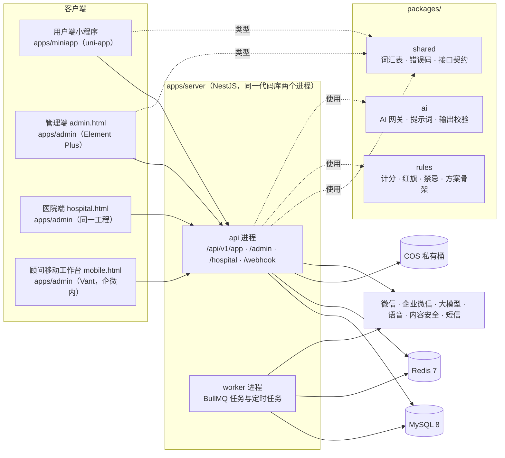

# 架构总览

> 产品需求以 [`docs/product/产品设计与开发文档_v1.0.md`](../product/产品设计与开发文档_v1.0.md) 为准（下文 §x 均指该文档章节）。
> 技术决策见 [`adr/`](adr/)；编码约定见 [`../conventions/`](../conventions/)；issue 与目录的对应关系见 [`ownership.md`](ownership.md)。

## 1. 系统组成



## 2. 仓库结构

```text
Xueji/
├── apps/
│   ├── server/                      NestJS（api + worker）
│   │   ├── prisma/schema/*.prisma   多文件 schema，一个域一个文件（ADR 0003）
│   │   ├── prisma/migrations/       迁移（只追加）
│   │   ├── prisma/seed/*.seed.ts    种子，按文件名顺序执行
│   │   └── src/
│   │       ├── common/              横切基础设施：日志、Prisma、错误、信封、鉴权、权限、审计、加密、队列
│   │       ├── config/              核心环境变量
│   │       ├── modules/<模块>/      58 个功能模块（已预注册，见 modules/index.ts）
│   │       ├── bootstrap.ts         应用装配（api 与测试共用）
│   │       ├── main.ts / worker.ts  两个进程入口
│   │       └── generated/prisma/    Prisma 客户端（生成物，不提交）
│   ├── admin/                       三入口：admin.html / hospital.html / mobile.html
│   │   └── src/
│   │       ├── entries/{admin,hospital,mobile}/   各端布局、路由（自动收集）
│   │       ├── modules/<功能>/       页面 + {admin,hospital,mobile}.routes.ts
│   │       └── shared/              HTTP 客户端、路由注册、主题
│   └── miniapp/                     uni-app 小程序
│       └── src/
│           ├── pages/ · pkg-*/       43 个页面（已全部注册，均为占位页）
│           ├── components/{base,home,quiz}/
│           ├── elder/  styles/      乐龄模式与设计令牌
│           ├── api/  stores/        每个域一个文件
│           └── pages.json           预注册的页面清单（只追加）
├── packages/
│   ├── shared/   词汇表（core/enums.ts）、错误码与信封（core/response.ts）、契约（contracts/<域>.ts）
│   ├── rules/    规则引擎纯函数（types.ts 是契约）
│   └── ai/       AI 网关（types.ts 是契约）
├── evals/        AI 评测集与报告
├── docker/       本地依赖与部署
└── docs/         产品文档、架构、约定、设计
```

## 3. 服务端分层与请求链路

```text
请求 → pino-http（requestId）
     → AuthGuard（校验 JWT 与 aud：app / admin / hospital 互不通用）
     → PermissionGuard（@Permission('health:view')）
     → ConsentGuard（@RequireConsent('C2')，缺失返回 40010 + consentType）
     → ZodValidationPipe（契约校验，失败 40020 + fieldErrors）
     → Controller → Service（数据范围在仓储层注入：all / store / self；医院端强制 hospital_id）
     → AuditInterceptor（@Audit('health.view') 成功后写 audit_log）
     → EnvelopeInterceptor（{ code: 0, message, data, requestId }）
异常 → AllExceptionsFilter（BizException / Zod / Http → 统一信封）
```

- **控制器按端拆文件**：`<模块>.app.controller.ts`（`/app/...`）、`<模块>.admin.controller.ts`、`<模块>.hospital.controller.ts`，便于按 aud 挂守卫、按端做越权测试。
- **模块间协作**：同步调用 → import 对方模块导出的 Service；异步 / 解耦 → 领域事件（如 `consent.revoked`、`assessment.completed`、`referral.returned`），由订阅方各自处理（§9.10 授权撤回就是典型的事件扇出）。
- **定时与异步任务**：处理器写在各自模块内，只在 `APP_ROLE=worker` 时注册；任务清单见 §13.5。

## 4. 安全不变量（任何 issue 都不能破坏）

1. 红旗、风险等级、禁忌、方案骨架**只由规则引擎决定**，AI 只写文案（§1.5、§10.1）。
2. L3 / L2 处理全程不调用 AI，使用医生确认过的固定模板（§4.4）。
3. 健康数据：字段加密 + 单独授权（C2）+ 权限 + 审计；不得用于营销推荐；医院只看到转介快照（§2.2、§7.2）。
4. 任何员工默认看不到魔镜聊天内容，只能看到预警片段（§2.2、§6.2.15）。
5. 前台不出现"高端 / 中端 / 低端"、"老人 / 老年版"，不按画像差别定价（§2.3、§4.15）。
6. 医疗推荐、红旗处理、体检推荐不因会员等级而不同（§1.5）。
7. 真实客户数据不得进入 dev / staging、测试、种子、评测集（§13.6）。

## 5. 环境

| 环境 | 用途 | 数据 |
|---|---|---|
| dev | 本地（`pnpm db:up` 起 MySQL / Redis / MinIO） | 虚构数据 |
| staging | 测试、试点前验收、小程序体验版 | 虚构 + 脱敏样本 |
| prod | 正式 | 真实数据 |
